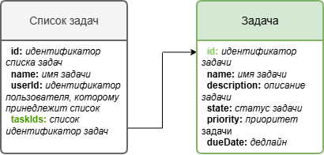
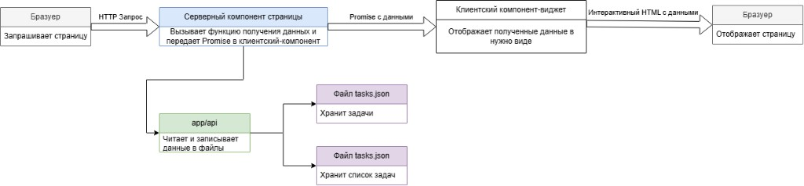
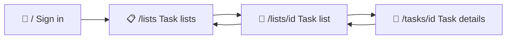

#  Task Manager

**English** | [Русский](./README.ru.md)

> **Like this project?** If this app helps you stay productive, please leave a Star ⭐️ in the top right corner. Your support motivates me to develop new features and make it even better!

Web application for managing task lists.

               

      

---

## 📑 Table of contents

- [1. Technical documentation](#1-technical-documentation)
  - [1.1. Technologies](#11-technologies-used-in-the-project)
  - [1.2. Local development](#12-local-development-guide)
  - [1.3. API](#13-api-appapi)
  - [1.4. Data flow](#14-how-data-is-organized-in-the-app)
- [2. Feature overview](#2-feature-overview)
  - [2.1. Screen map](#21-screen-map)
- [3. Live-demo](#3-live-demo)

---

## 1. Technical documentation

### 1.1. Technologies used in the project

| Technology | Purpose |
| :--------- | :------ |
|  **Next.js** | Framework (App Router): pages, API routes, Server Actions, SSR/CSR.<br>[Docs ↗](https://nextjs.org/docs) |
|  **React** | UI library for client and server components.<br>[Docs ↗](https://react.dev) |
|  **TypeScript** | Static typing for the source code.<br>[Docs ↗](https://www.typescriptlang.org/docs) |
| 🧩 **Feature-Sliced Design (FSD)** | Layers `app` / `widgets` / `features` / `entities` / `shared` with public slice APIs.<br>[Docs ↗](https://feature-sliced.design) |
|  **ESLint** | Linter: Next.js, TypeScript, and FSD (`eslint-plugin-fsd-lint`).<br>[Docs ↗](https://eslint.org/docs/latest) |
|  **Vitest** | Unit tests (including browser tests via Playwright).<br>[Docs ↗](https://vitest.dev) |
|  **Storybook** | Isolated UI development and preview.<br>[Docs ↗](https://storybook.js.org/docs) |
| 🎨 **next-themes** | Theme switching (default / light / dark).<br>[Repository ↗](https://github.com/pacocoursey/next-themes) |
| 📝 **react-hook-form** | Form handling (login, create, and edit).<br>[Docs ↗](https://react-hook-form.com) |
| 🔑 **jsonwebtoken** | Issue and verify JWTs for authentication.<br>[Repository ↗](https://github.com/auth0/node-jsonwebtoken) |
|  **CSS Modules** | Scoped component styles.<br>[Repository ↗](https://github.com/css-modules/css-modules) |

**📦 Current technology versions**

| Technology | Version |
| :--------- | :-----: |
| Next.js | `16.4.2` |
| React / React DOM | `19.3.0` |
| TypeScript | `5.9.3` |
| ESLint | `9.39.5` |
| eslint-plugin-fsd-lint | `1.2.1` |
| Vitest | `5.0.5` |
| Storybook | `10.6.3` |
| next-themes | `0.4.6` |
| react-hook-form | `7.90.0` |
| jsonwebtoken | `9.0.3` |
| Node.js | `≥ 20` |

> Up-to-date values are in `package.json` / `package-lock.json`.

---


### 1.2. Local development guide

#### 🚀 Quick start

**bash / zsh**

```bash
npm install
npm run playwright:install                         
npm run dev                                        # → http://localhost:3000
```
**PowerShell**

```powershell
npm install
npm run playwright:install                         
npm run dev                                        # → http://localhost:3000
```
#### Running the project locally

**Step-by-step setup**

**1. 🐙 Git** — install and configure. [Download ↗](https://git-scm.com/downloads)

```bash
git --version
```

**2. 🟢 Node.js** — version **≥ 20** (LTS). [Download ↗](https://nodejs.org)

```bash
node --version
```

**3. 📦 npm** — ships with Node.js. [Docs ↗](https://docs.npmjs.com)

```bash
npm --version
```

**4. 📥 Dependencies**

```bash
npm install
```

**5. 🎭 Playwright Chromium** — **required once** for `npm run test` / `npm run test:run` (Storybook browser tests). Repeat after updating `playwright`:

```bash
npm run playwright:install
```

> Without this step, the test run will fail. Not needed for `npm run dev` or `npm run storybook`.

**6. 🔐 Environment variables**

| Variable | Description |
| :------- | :---------- |
| `APP_BASE_URL` | Base URL (default `http://localhost:3000`) |
| `JWT_SECRET` | JWT signing secret |
| `DEFAULT_USER_ID` | Default user ID |
| `DEFAULT_USER_EMAIL` | Default user email |
| `DEFAULT_USER_PASSWORD` | Default user password |

**7. ▶️ Dev server**

```bash
npm run dev
```

App: [http://localhost:3000](http://localhost:3000)

```bash
npm run build   # production build
npm run start   # run the built app
```

#### Code quality scripts

| Command | Purpose |
| :------ | :------ |
| `npm run typecheck` | ✅ TypeScript check |
| `npm run lint` | 🧭 ESLint + FSD rules |
| `npm run test` | 🧪 Unit tests (watch) |
| `npm run test:run` | 🧪 Unit tests |
| `npm run test:storybook` |  📚 Storybook tests |
| `npm run storybook` | 📚 Storybook at [localhost:6006](http://localhost:6006) |
| `npm run build-storybook` | 📚 Static Storybook build |

**Check details**

##### TypeScript check

```bash
npm run typecheck
```

##### FSD architecture check

Feature-Sliced Design rules in ESLint (`eslint-plugin-fsd-lint`):

```bash
npm run lint
```

Among other things, this checks:

- forbidden imports between layers;
- cross-slice dependencies;
- public slice APIs;
- relative imports;
- import order.

##### Running unit tests

> **⚠ Prerequisite:** before the first `npm run test` / `npm run test:run`, run `npm run playwright:install` (see “Running the project locally”, step 5). Otherwise Storybook browser tests in Vitest will fail. Repeat only after updating `playwright`.

```bash
npm run test       
npm run test:run   
```

##### Running Storybook

```bash
npm run storybook
```

Storybook: [http://localhost:6006](http://localhost:6006)

```bash
npm run build-storybook
```

---

### 1.3. API (`app/api`)

Data is stored in JSON files:

| File | Path |
| :--- | :--- |
| 📋 Task lists | `src/shared/lib/file-storage/data/task-lists.json` |
| ✅ Tasks | `src/shared/lib/file-storage/data/tasks.json` |

**Task statuses (`state`):** `new` · `in progress` · `done` · `overdue`

API routes under `/api/data/*` require the `Authorization: Bearer <token>` header. Without a valid session the response is `401`. `POST /api/auth/login` stays open. Pages `/lists` and `/tasks` still validate the `session_token` cookie.

**📡 Endpoint table**

| Method | Path | Parameters | Description | Writes to |
| :---: | :--- | :-------- | :------- | :--------- |
| `POST` | `/api/auth/login` | **Body:** `email`, `password` | Validates `DEFAULT_USER_`* from `.env`. Response: `{ userSessionPayload: { userId, email } }`. The JWT cookie is set by a Server Action, not this route. | - |
| `GET` | `/api/data/task-lists` | — | All lists (DTO + nested tasks). | `task-lists.json`, `tasks.json` |
| `POST` | `/api/data/task-lists` | **Body:** `name` (required); `taskIds` | Creates a list (`id` uuid, `userId` from `DEFAULT_USER_ID`). | `task-lists.json` |
| `GET` | `/api/data/task-lists/[id]` | **Path:** `id` | One list with tasks. `404` if missing. | `task-lists.json`, `tasks.json` |
| `PUT` | `/api/data/task-lists/[id]` | **Path:** `id`; **Body:** `name` | Rename. `404` if missing. | `task-lists.json` |
| `DELETE` | `/api/data/task-lists/[id]` | **Path:** `id` | Deletes the list (does not touch tasks in `tasks.json`). `404` if missing. | `task-lists.json` |
| `GET` | `/api/data/tasks` | — | All tasks. | `tasks.json` |
| `POST` | `/api/data/tasks` | **Body:** `name`, `description`, `state`, `priority`, `dueDate`, `taskListId` | Creates a task and adds its `id` to the list’s `taskIds`. | `task-lists.json`, `tasks.json` |
| `GET` | `/api/data/tasks/[id]` | **Path:** `id` | Task + `taskListId`, `taskListName`. `404` if missing. | `task-lists.json`, `tasks.json` |
| `PUT` | `/api/data/tasks/[id]` | **Path:** `id`; **Body (optional):** `name`, `description`, `state`, `priority`, `dueDate` | Update. Unspecified fields are kept. `404` if missing. | `tasks.json` |
| `DELETE` | `/api/data/tasks/[id]` | **Path:** `id` | Deletes the task and removes its `id` from `taskIds` in all lists. `404` if missing. | `task-lists.json`, `tasks.json` |

---

### 1.4. How data is organized in the app

#### Data model

A task list references tasks via `taskIds`.



#### Data flow



---

## 2. Feature overview

### 2.1. Screen map



| Screen | Route | What it does |
| :----- | :---- | :----------- |
| 🔐 Sign in | `/` | Authentication and authorization |
| 📋 Task lists | `/lists` | Shows task lists |
| 📑 Task list | `/lists/[id]` | Shows tasks in a list |
| 📝 Task | `/tasks/[id]` | Shows a single task |

### 🔐 Sign in

- Home (`/`) — login form.
- Email + password → JWT in cookie → redirect to `/lists`.
- Stub account from `.env`: `DEFAULT_USER_EMAIL`, `DEFAULT_USER_PASSWORD`.
-  Show / hide password in the input.
- **Alt+C** — fill stub credentials.

### 📋 Task lists

- Cards for all lists.
- Search by name.
- Create a list (modal); **Alt+C** — stub name.
-  Rename and  delete via the card menu ().
- Click a card → `/lists/[id]`.

### 📑 Task list

- Title, task count, progress.
- Table: name, status, priority, due date, actions.
- Filter by status.
- Auto-sort: incomplete first; overdue first → nearest due date → priority (no column clicks).
- Highlight soon-due (≤ 48 h) and overdue tasks.
- Change status in the table with rollback on error.
- Add / Edit / Delete via modals; **Alt+C** in the add form.
- Navigate to `/tasks/[id]`.
-  Back to `/lists`.

### 📝 Task

-  Back to the list (`To list «…»`).
- Title, description (or “No description”).
- Priority, due date with highlight for due within 48 hours / overdue.
- Change status with rollback on error.
-  Edit and  delete; after delete — return to the list.

### 🎨 Theme

- Toggle in the header .
- Modes: **system**, **light**, **dark**.
- Choice is persisted and applied across the UI.

### ⚠️ Errors and loading

- Skeletons while loading data on `/lists`, `/lists/[id]`, `/tasks/[id]`.
-  404 — `ErrorView` for unknown routes / missing resources.
-  500 — error screen with retry.

---

## 3. Live-demo


