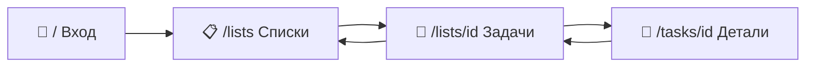

# ✅ Менеджер задач

Web-приложение для управления списками задач (MVP).

<p align="center">
  
  
  
  
  
  
</p>

<p align="center">
  <a href="#-быстрый-старт"></a>
  <a href="#-api-appapi"></a>
  <a href="#2--описание-функций-приложения"></a>
</p>

---

## 📑 Содержание

- [1. Техническая документация](#1--техническая-документация)
  - [1.1. Технологии](#11--технологии-используемые-в-проекте)
  - [Локальная разработка](#-инструкция-для-локальной-разработки)
  - [1.3. API](#13--api-appapi)
- [2. Описание функций](#2--описание-функций-приложения)
- [Карта экранов](#-карта-экранов)

---

## 🗺️ Карта экранов



| Экран | Маршрут | Что делает |
| :---- | :------ | :--------- |
| 🔐 Вход | `/` | JWT-сессия, переход к спискам |
| 📋 Списки | `/lists` | Карточки, поиск, CRUD списков |
| 📑 Список | `/lists/[id]` | Таблица задач, фильтры, статусы |
| 📝 Задача | `/tasks/[id]` | Детали, edit / delete |
| 🚫 404 / 💥 500 | — | `ErrorView` + retry на 500 |

---

## 1. 📘 Техническая документация

### 1.1. 🧰 Технологии, используемые в проекте

#### Описание технологий

| Технология | Назначение |
| :--------- | :--------- |
|  **Next.js** | Фреймворк (App Router): страницы, API routes, Server Actions, SSR/CSR. [Документация ↗](https://nextjs.org/docs) |
|  **React** | UI-библиотека для клиентских и серверных компонентов. [Документация ↗](https://react.dev) |
|  **TypeScript** | Статическая типизация исходного кода. [Документация ↗](https://www.typescriptlang.org/docs) |
| 🧩 **Feature-Sliced Design (FSD)** | Слои `app` / `widgets` / `features` / `entities` / `shared` с публичными API слайсов. [Документация ↗](https://feature-sliced.design) |
|  **ESLint** | Линтер: Next.js, TypeScript и FSD (`eslint-plugin-fsd-lint`). [Документация ↗](https://eslint.org/docs/latest) |
|  **Vitest** | Unit-тесты (в т.ч. browser через Playwright). [Документация ↗](https://vitest.dev) |
|  **Storybook** | Изолированная разработка и просмотр UI. [Документация ↗](https://storybook.js.org/docs) |
| 🎨 **next-themes** | Переключение темы (default / light / dark). [Репозиторий ↗](https://github.com/pacocoursey/next-themes) |
| 📝 **react-hook-form** | Управление формами (вход, создание и редактирование). [Документация ↗](https://react-hook-form.com) |
| 🔑 **jsonwebtoken** | Выдача и проверка JWT при аутентификации. [Репозиторий ↗](https://github.com/auth0/node-jsonwebtoken) |
| 💅 **CSS Modules** | Локальные стили компонентов. [Репозиторий ↗](https://github.com/css-modules/css-modules) |

<details>
<summary><strong>📦 Текущие версии технологий</strong> — нажмите, чтобы раскрыть</summary>

<br />

| Технология | Версия |
| :--------- | :----: |
| Next.js | `16.4.2` |
| React / React DOM | `19.3.0` |
| TypeScript | `5.9.3` |
| ESLint | `9.39.5` |
| eslint-plugin-fsd-lint | `1.2.1` |
| Vitest | `5.0.5` |
| Storybook | `10.6.3` |
| next-themes | `0.4.6` |
| react-hook-form | `7.90.0` |
| jsonwebtoken | `9.0.3` |
| Node.js (рекомендуется) | `≥ 20` |

> Версии соответствуют установленным в проекте на момент обновления README. Актуальные значения — в `package.json` / `package-lock.json`.

</details>

---

### 🛠️ Инструкция для локальной разработки

#### 🚀 Быстрый старт

```bash
git --version && node --version && npm --version   # проверки
npm install
npm run playwright:install                         # один раз (для тестов)
npm run dev                                        # → http://localhost:3000
```

#### Локальный запуск проекта

<details open>
<summary><strong>Пошаговая установка</strong></summary>

<br />

**1. 🐙 Git** — установка и настройка (клонирование, ветки). [Скачать ↗](https://git-scm.com/downloads)

```bash
git --version
```

**2. 🟢 Node.js** — версия **≥ 20** (LTS). [Скачать ↗](https://nodejs.org)

```bash
node --version
```

**3. 📦 npm** — идёт вместе с Node.js. [Документация ↗](https://docs.npmjs.com)

```bash
npm --version
```

**4. 📥 Зависимости**

```bash
npm install
```

**5. 🎭 Playwright Chromium** — **обязательно один раз** для `npm run test` / `npm run test:run` (Storybook browser-тесты). Повторите после обновления `playwright`:

```bash
npm run playwright:install
```

> Без этого шага прогон тестов упадёт. Для `npm run dev` и `npm run storybook` шаг не нужен.

**6. 🔐 Переменные окружения**

Файл `.env` уже в репозитории (stub для MVP). Локальные переопределения — в `.env.local` (в `.gitignore`).

| Переменная | Описание |
| :--------- | :------- |
| `APP_BASE_URL` | Базовый URL (по умолчанию `http://localhost:3000`) |
| `DEFAULT_USER_ID` | ID пользователя по умолчанию |
| `DEFAULT_USER_EMAIL` | Email по умолчанию |
| `DEFAULT_USER_PASSWORD` | Пароль по умолчанию |

**7. ▶️ Dev-сервер**

```bash
npm run dev
```

Приложение: [http://localhost:3000](http://localhost:3000)

```bash
npm run build   # production-сборка
npm run start   # запуск собранного приложения
```

</details>

#### Запуск плагинов для проверки кода

| Команда | Назначение |
| :------ | :--------- |
| `npm run typecheck` | ✅ Проверка TypeScript без эмита |
| `npm run lint` | 🧭 ESLint + правила FSD |
| `npm run test` | 🧪 Unit-тесты (watch) |
| `npm run test:run` | 🧪 Unit-тесты (один прогон) |
| `npm run storybook` | 📚 Storybook на [localhost:6006](http://localhost:6006) |
| `npm run build-storybook` | 📚 Статическая сборка Storybook |

<details>
<summary><strong>Детали по проверкам</strong></summary>

<br />

##### Проверка TypeScript

```bash
npm run typecheck
```

##### Проверка FSD-архитектуры

Правила Feature-Sliced Design в ESLint (`eslint-plugin-fsd-lint`):

```bash
npm run lint
```

Проверяются, в частности:

- запрещённые импорты между слоями;
- cross-slice зависимости;
- публичный API слайсов;
- относительные импорты;
- порядок импортов.

##### Запуск unit-тестов

> **⚠ Предусловие:** перед первым `npm run test` / `npm run test:run` выполните `npm run playwright:install` (см. «Локальный запуск проекта», шаг 5). Иначе Storybook browser-тесты в Vitest завершатся ошибкой. Повторно — только после обновления `playwright`.

```bash
npm run test       # watch
npm run test:run   # один прогон
```

##### Запуск Storybook

```bash
npm run storybook
```

Storybook: [http://localhost:6006](http://localhost:6006)

```bash
npm run build-storybook
```

</details>

---

### 1.3. 🔌 API (`app/api`)

Данные хранятся в JSON:

| Файл | Путь |
| :--- | :--- |
| 📋 Списки задач | `src/shared/lib/file-storage/data/task-lists.json` |
| ✅ Задачи | `src/shared/lib/file-storage/data/tasks.json` |

Чтение/запись: `readDataFromFile` / `writeDataToFile` (`src/shared/lib/file-storage`).

**Статусы задачи (`state`):** `new` · `in progress` · `done` · `overdue`

<details>
<summary><strong>📡 Таблица эндпоинтов</strong> — нажмите, чтобы раскрыть</summary>

<br />

| Метод | Путь | Параметры | Описание | Куда пишет |
| :---: | :--- | :-------- | :------- | :--------- |
| `POST` | `/api/auth/login` | **Body:** `email`, `password` | Проверяет `DEFAULT_USER_*` из `.env`. Ответ: `{ userSessionPayload: { userId, email } }`. JWT в cookie ставит Server Action, не этот роут. | Не пишет |
| `GET` | `/api/data/task-lists` | — | Все списки (DTO + вложенные задачи). | Читает оба JSON |
| `POST` | `/api/data/task-lists` | **Body:** `name` (обяз.); `taskIds`? | Создаёт список (`id` uuid, `userId` из `DEFAULT_USER_ID`). | `task-lists.json` |
| `GET` | `/api/data/task-lists/[id]` | **Path:** `id` | Один список с задачами. `404`, если нет. | Читает оба JSON |
| `PUT` | `/api/data/task-lists/[id]` | **Path:** `id`; **Body:** `name` | Переименование. `404`, если нет. | `task-lists.json` |
| `DELETE` | `/api/data/task-lists/[id]` | **Path:** `id` | Удаляет список (задачи в `tasks.json` не трогает). `404`, если нет. | `task-lists.json` |
| `GET` | `/api/data/tasks` | — | Все задачи. | Читает `tasks.json` |
| `POST` | `/api/data/tasks` | **Body:** `name`, `description`, `state`, `priority`, `dueDate`, `taskListId` | Создаёт задачу и добавляет `id` в `taskIds` списка. | оба JSON |
| `GET` | `/api/data/tasks/[id]` | **Path:** `id` | Задача + `taskListId`, `taskListName`. `404`, если нет. | Читает оба JSON |
| `PUT` | `/api/data/tasks/[id]` | **Path:** `id`; **Body (опц.):** `name`, `description`, `state`, `priority`, `dueDate` | Обновление. Незаданные поля сохраняются. `404`, если нет. | `tasks.json` |
| `DELETE` | `/api/data/tasks/[id]` | **Path:** `id` | Удаляет задачу и убирает `id` из `taskIds` всех списков. `404`, если нет. | оба JSON |

</details>

---

## 2. ✅ Описание функций приложения

### 🔐 Вход в систему

- Главная (`/`) — форма входа для работы с задачами.
- Email + пароль → JWT в cookie → редирект на `/lists`.
- Stub-учётка из `.env`: `DEFAULT_USER_EMAIL`, `DEFAULT_USER_PASSWORD`.
-  Показ / скрытие пароля в поле.
- Клавиша **Alt+C** — подстановка stub-данных (совпадают с `.env` MVP).

### 📋 Списки задач (`/lists`)

- Карточки всех списков.
- На карточке: название, число задач, метрики по статусам, прогресс, индикаторы просрочки и дедлайнов ≤ 48 ч.
- Поиск по названию.
- Создание списка (модалка); **Alt+C** — stub-название.
-  Переименование и  удаление через меню карточки ().
- Клик по карточке → `/lists/[id]`.

### 📑 Список задач (`/lists/[id]`)

- Заголовок, количество задач, прогресс.
- Таблица: название (описание — под ним), статус, приоритет, дедлайн, действия.
- Фильтр по статусу (все / отдельные).
- Автосортировка: незавершённые выше; просроченные первыми → ближайший дедлайн → приоритет (без клика по колонкам).
- Подсветка скорого дедлайна (≤ 48 ч) и просрочки.
- Смена статуса в таблице с откатом при ошибке.
- Add / edit / delete через модалки; **Alt+C** в форме добавления.
- Переход на `/tasks/[id]`.
-  Назад к `/lists`.

### 📝 Задача (`/tasks/[id]`)

-  Назад к списку (`К списку «…»`).
- Заголовок, описание (или «Описание не указано»).
- Приоритет, дедлайн с подсветкой soon / overdue.
- Смена статуса с откатом при ошибке.
-  Редактирование и  удаление; после удаления — возврат к списку.

### 🎨 Цветовая тема

- Переключатель в шапке (`next-themes`) .
- Режимы: **системная** (`default` — базовая палитра приложения, не тема ОС), **светлая**, **тёмная**.
- Выбор сохраняется и применяется ко всему UI.

### ⚠️ Ошибки и загрузка

- Скелетоны на `/lists`, `/lists/[id]`, `/tasks/[id]` пока грузятся данные.
-  404 — `ErrorView` для неизвестного маршрута / сущности.
-  500 — экран ошибки с повтором действия.
